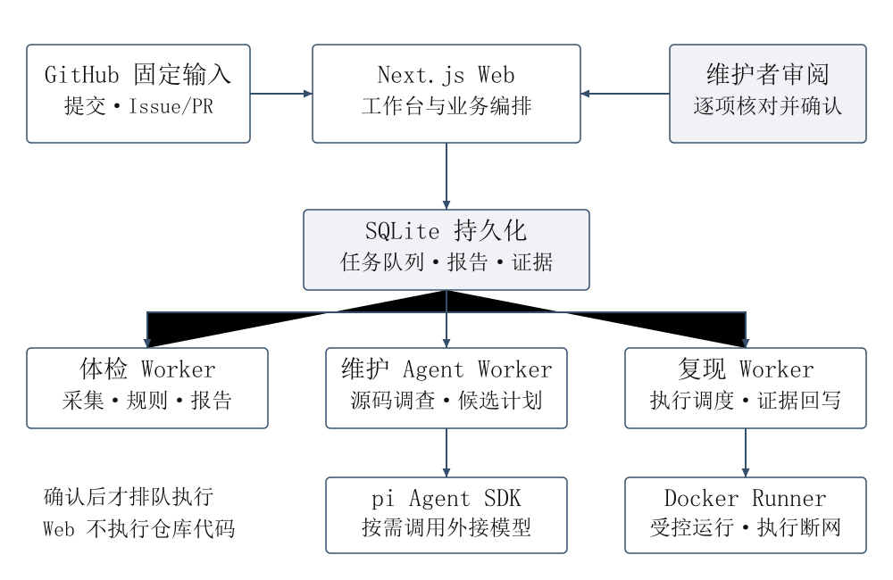
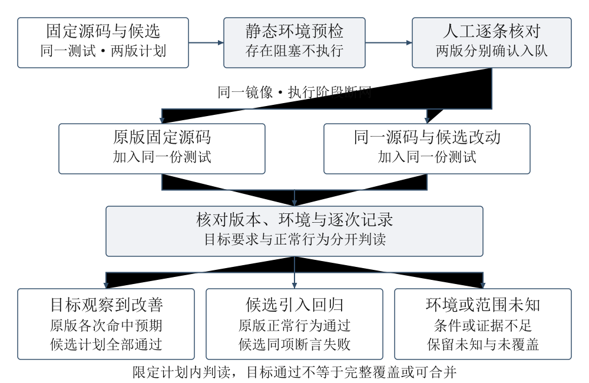
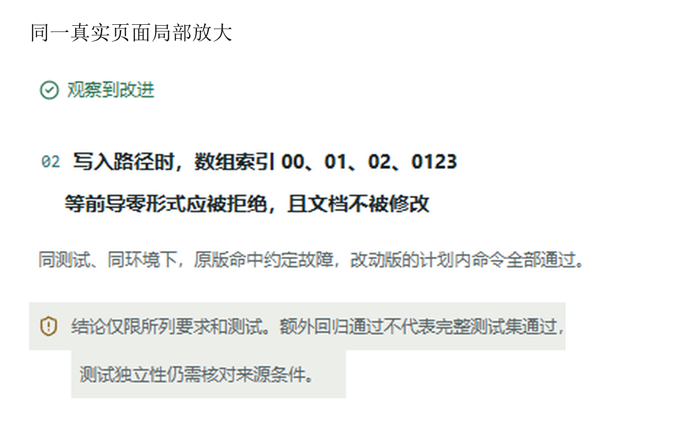

# RepoCare开源维护助手

## 作品简介

开源项目维护者收到AI修复建议后，仍需判断改动是否满足需求、是否影响正常行为。RepoCare把问题原文、固定版本源码、候选补丁和执行证据放入同一工作台，由AI调查并提议方案，维护者核对后，用相同测试对照原版与候选。系统分别呈现目标改进、候选回归和环境阻塞，保留失败、修订与未验证范围。两个公开历史案例经代理反馈修订后通过所列外部检查，页面实践完成确认、执行、刷新及导出。作品以可审阅的维护流程为核心，提供源码、部署说明和脱敏评测索引，适用于支持范围内的小型开源项目维护。

## 一、作品概述

### （一）背景与具体问题

一名维护者收到“修复数组索引校验”的建议时，不能只看补丁解释。改动可能挡住错误输入，也可能把正常输入一并拒绝；测试命令还可能因缺少依赖而失败。维护者需要分清：问题是否出现、候选是否改善目标、正常行为是否受影响，以及哪些部分还没有验证。

现有协作通常分散在GitHub问题讨论、代码差异、AI对话和本地测试日志中。RepoCare将这些材料关联到同一代码版本，让维护者沿着需求、改动、检查与结果逐项审阅。项目的价值集中在帮助人作出有依据的维护判断。

### （二）目标 参赛方向与作品形态

作品申报“AI开发工具与开源协作”，形态为网页开发工具和受控维护工作流。主要用户是中小型开源项目维护者；贡献者可提供问题、候选改动或额外验收测试。项目体检、问题单（Issue）分诊、合并请求（PR）审阅和文档草稿构成入口，需求与改动对照是本报告重点验证的流程。

核心目标是交付一份可审阅记录：固定代码版本、需求原文、候选补丁、测试内容、实际命令与结果。维护者据此决定继续调查、补充环境、修订候选或整理交付。当前执行验证聚焦采用Python语言及pytest测试工具的小型公开GitHub项目，不将配置识别能力解释为全语言修复能力。

### （三）核心亮点

作品把需求对应、相同测试的双版本执行和有范围的结果表达结合起来。生产改动只进入候选，测试同时应用于两版；执行前先检查环境，再由维护者逐条核对并分别确认。模型建议、真实运行和人工验收各自留档，失败与后续修订均可回查。

现有证据支持局部目标改进、候选正常行为回归的发现，以及环境缺口的识别。源码、安装说明、测试与脱敏案例索引构成可复用成果；真实使用者耗时和维护者采用尚未测量。

## 二、需求分析与总体方案

### （一）需求来源与优先级

本项目采用公开历史案例分析和产品开发实践识别需求，没有把代理模拟当成真实用户访谈。案例中出现了三类直接影响维护判断的问题：候选只修复部分要求；目标通过但相反配置的正常行为被破坏；运行环境缺依赖，无法据失败日志确认缺陷。来源与逐案结果见附录证据目录。

| 维护环节 | 现有材料中的困难 | RepoCare的对应处理 |
| --- | --- | --- |
| 判断需求是否被覆盖 | 问题原文与代码、测试分散 | 将原文引用、生产路径和目标检查关联保存 |
| 判断候选是否有效 | 只看候选通过，无法确认原问题 | 同一测试分别用于固定原版和候选 |
| 判断是否影响正常行为 | 目标检查不覆盖其他开关或输入 | 正常行为检查另列，并保留未检查范围 |
| 判断运行失败原因 | 缺依赖与断言失败容易混淆 | 环境预检、实际日志与目标结论分别表达 |

优先级首先是判断依据可追溯，其次是流程可恢复和结果易读。图形导航用于定位任务，不替代测试证据。暂未扩展多托管平台、跨主机队列或自动合并，以便将工作集中在一条可验证流程。

### （二）总体结构与输入输出

系统接收GitHub仓库、固定代码版本、问题或PR、项目约定及维护者目标。AI读取允许范围内的源码，提出候选和检查计划；业务层校验引用、路径、版本与命令，保存待确认任务。执行器在维护者确认后运行计划，输出逐次日志、测试结果和可下载记录。

Web提供业务界面，三个后台工作进程（Worker）分别处理体检、维护调查和隔离执行，SQLite保存任务与证据。pi SDK提供智能体循环和模型适配。Docker提供项目代码的受控执行环境，执行阶段断网；仓库代码不由Web进程在宿主机执行。

### （三）可行性与资源投入

作品采用单机Web、SQLite和现有开源组件，可在已有开发电脑及Docker环境中运行，不训练大模型，也不要求专用GPU。模型通过配置的API调用。体检基础规则、记录读取和导出不需要模型；模型请求集中在主动发起的调查和方案生成。

新增两案的首阶段各限制16次模型请求、32次工具调用和180秒，反馈阶段另行记录，实际累计31次请求。用量用于核对资源投入，不换算没有账单依据的费用。团队人工工时、硬件配置与总成本记录：xx，待按实际投入补齐。

## 三、AI技术与开源及第三方资源选择

### （一）AI的作用及输出验证

维护问题通常使用自然语言描述，相关代码、测试和协作规则因项目而异。AI用于理解目标、选择调查位置、解释源码关系，并提议补丁、测试和回复草稿。固定规则承担边界明确的校验，实际测试承担选定行为的运行验证，维护者承担语义核对与交付决策。

AI提出的计划必须通过输入结构、原文引用、文件范围和命令规则校验。通过这些校验只表示计划可以继续审阅；是否满足真实需求，要结合两版运行和人工核对判断。系统要求每个结论引用已读取的依据，未运行时保留待验证状态。

### （二）资源选择与自主开发边界

| 层次 | 使用的能力 | 作品实现与责任 |
| --- | --- | --- |
| 配置的模型API | 需求理解、源码调查、候选生成 | 组织业务上下文和工具；核对输出并记录失败 |
| pi SDK 0.73.1 | Agent循环、工具调用、模型适配 | 定义维护工具、预算、状态恢复及交付约束 |
| Next.js React SQLite | 界面、服务接口、本地持久化 | 实现业务页面、队列、版本关联与权限检查 |
| Docker pytest | 隔离环境与测试执行 | 编排两版计划、人工确认和有范围的结果判读 |

API实验记录的模型ID为deepseek-flash，不能据ID断言底层权重版本。核心npm版本、来源、许可证、使用方式及关键义务见附录资源说明和逐项CSV。模型服务、GitHub API与开发工具适用服务条款，不能用模型或框架的开源许可代替。

### （三）AI与开源协作的融合

开源仓库既是问题来源，也是调查、候选和验证的对象。流程读取真实问题与项目约定，把AI建议绑定到具体源码，再用开源测试工具形成可核对记录，最后由维护者审阅交付。自研重点是这些材料之间的关联和执行、结论边界，不把模型、pi循环或现成组件本身计为自主创新。

## 四、设计与实现过程

### （一）核心操作流程

用户从项目概览进入具体Issue或PR，查看AI调查依据与候选；随后核对问题原文、生产改动、目标测试和正常行为检查。系统先做环境检查，维护者再分别确认两版执行。完成后可展开逐次输出，导出Markdown、JSON及候选补丁，刷新页面继续审阅。

目标检查用于回答“原问题是否被候选改善”，正常行为检查用于观察“所选正常输入是否受到影响”。两类检查各有范围，部分通过不能代替完整项目测试。人工另供的验收测试独立保存来源声明和内容指纹，保留原模型方案，不根据提交者声明自动认定盲测。

### （二）关键实现机制

固定输入：每次调查使用固定提交，读取文件时核对路径、内容与版本。需求原文、补丁、测试和计划分别记录内容指纹，输入变化后提示原结论过期。PR还需在确认时检查最新上下文，避免用旧代码结果解释新改动。

公平对照：两版都加入同一份测试，只有候选版应用生产补丁。以JSON Pointer为例，读取和写入前导零索引应各自有目标检查，正常索引及其他合法行为另测。这样能观察“原版在相同检查下失败、候选通过”的差异，而不把新增测试本身当成修复。

结果分类：系统结合命令、断言信号、各次尝试与环境记录判断局部改进。依赖缺失或测试收集失败归入环境受阻；原版正常行为通过而候选失败时突出候选回归。界面与导出共用判读逻辑，保留缺少记录及未覆盖范围。

持久流程：任务、候选和实际结果落入数据库；后台执行有独立队列和租约，支持中断后恢复已有记录。模型报告按实际已保存内容生成，报告预算不足时保留未完成事实，不能用说明文字补造执行成功。

### （三）过程记录与实际分工

版本记录可核对需求与人工验收、固定PR源码读取、预算收尾、pytest插件预检及确认框布局等实现。问题处理采用“保留失败、定位原因、修订实现、运行相关检查”的方式，历史案例的调试重跑不计为新增独立样本。

| 参与者 | 实际工作 | 审核 修改与验证记录 |
| --- | --- | --- |
| 成员xx | xx | xx |
| 成员xx | xx | xx |
| Codex辅助工具 | 代码与文档草拟、问题定位、自动化检查及材料整理 | 自动化记录可查；团队人工审核和权属核查记录为xx |
| 产品配置模型 | 调查公开问题与源码，提出候选及计划 | 输出由业务校验、所列测试和维护者确认共同约束 |

身份与人工分工按参赛者要求暂用xx占位，提交前须按真实完成情况补齐；评审材料不填写指导教师信息。共同权利人授权、AI生成内容来源核查和服务条款确认仍由参赛团队据实完成。

## 五、成果展示与效果验证

### （一）JSON Pointer完整流程展示

本案例来自python-json-pointer的公开问题#63，固定v3.0.0。问题是数组索引的文本校验：数组路径/items/01应报错，而对象的/01仍是合法键，不能一概拒绝。AI根据固定源码提出生产补丁和测试，页面提供原文、差异及计划供维护者审阅，本次由授权代理模拟该角色。

首次计划的预期失败文本与实际测试框架报错不一致。该错误保留为首次部分交付，经一次代理诊断反馈后仅修订失败判据，生产与测试字节不变。该过程说明，保存补丁或计划仍需要运行与审阅，不能直接认定修复完成。

独立演示副本随后从实际页面完成环境检查、逐条核对、分别确认两版执行、读取结果、刷新恢复和三类文件下载。原版与候选各运行三次，与下述外部验收每版一次分别记录。图3展示真实保存页面的局部，重点是目标结果与仍未核验清楚的范围。

额外完整测试文件在原版包含新增目标失败，所以界面保留“目标有改进，其他行为尚未核验清楚”。这条提示帮助维护者继续补正常行为依据，避免将目标改善直接当成完整回归通过。页面实践由授权代理操作，不计作真人试用。

### （二）冻结外部检查与结果

为核对候选，两个历史输入均在首次生成前固定代码版本、需求、预算及外部目标与正常行为检查；生成和反馈阶段不提供这些检查正文。执行者读过公开Issue与源码，公开正文带诊断线索，因此属于有条件的案例验证。两案首次均存在缺口，表1记录反馈后的验收结果，并保留首次交付。

| 案例与检查范围 | 固定原版 | 反馈后候选 |
| --- | --- | --- |
| JSON Pointer：2项目标、2项正常行为 | 2项目标断言失败；2项正常通过 | 4个节点通过 |
| cachetools：3项目标、2项正常行为 | 3项目标断言失败；2项正常通过 | 5个节点通过 |

表1 冻结外部检查的双版本结果。每个版本执行一次，两版环境指纹一致，Python3.12.3、pytest9.0.2，执行断网。结果仅覆盖所列检查，不推算总体修复率。

cachetools案例提供了补充的错误分析：首次候选只修复外层缓存入口，清理和统计仍被内层覆盖；外部诊断指出实际行为缺口。一次代理反馈后，候选调整包装顺序并拆分模型计划中的目标节点，得到表1结果。冻结外部检查保持不变，两案均依赖反馈修订，不追认为首次自主成功。

另一个已参与开发的python-dotenv案例中，首版候选虽然满足目标，却破坏override=False的正常行为，额外检查发现该回归。该记录用于说明正常行为检查的作用，不作为本批新增样本或独立效果比较。完整过程和其他失败、澄清案例留在证据目录。

### （三）工程验证与未达到的目标

产品代码完成203项业务测试、15项隔离浏览器回归及生产构建，浏览器回归覆盖PR/Issue流程、概览3D、确认框键盘与窄屏布局。22项Runner受信任环境检查通过；独立数据卷的容器安装启动及健康检查通过。上述工程测试使用mock或合成数据，与真实历史维护案例分别统计。

已有记录证明核心维护流程可运行，且能将局部目标改善、候选回归和环境阻塞分别保留。当前仍缺少未参与开发者的真实试用、维护者采用、人工耗时对照与更广泛的新任务重复验证。没有用工程测试数量、同案多次执行或两个案例的结果估算通用准确率。

## 六、创新性与开放价值

### （一）与现有方案的关系

GitHub Agentic Workflows已有Issue分诊、澄清与相关问题检索示例；PR-Agent已有需求符合性和分块审查。RepoCare基于pi SDK等开源组件实现自身流程，不将分诊、审查或模型调用单项认作首创。表2说明作品自身的实现重点，与现有方案关系属于设计比较，未进行完整第三方产品的同条件实跑。

| 设计维度 | 已有能力参照 | RepoCare的实现重点 |
| --- | --- | --- |
| 问题理解与审查 | 分诊、需求符合性、分块审查 | 将调查、候选与验证留在原业务详情中 |
| 验证依据 | 检查说明、测试与执行结果 | 固定输入，关联原文、改动、同一测试与逐次记录 |
| 维护者决策 | 审阅建议及后续协作 | 逐条确认，分离目标、回归、环境与未知范围 |
| 成果交付 | 评论、补丁及报告 | 保留失败和修订，导出可核对记录与候选文件 |

表2 设计关系比较。列出参照不表示其他工具缺少相同能力，也不支持性能优劣结论。

### （二）可复用成果与开放方式

可复用成果包括RepoCare自主代码、部署配置、业务和浏览器测试、说明文档，以及脱敏案例索引。自主代码采用Apache-2.0，附LICENSE与NOTICE。源码包不含模型凭据、个人数据库、完整第三方案例源码或私有检查点；第三方资源保留各自许可。

现有cattrs历史案例提供自有检查代码和显式Runner复查入口，使用者可按固定来源验证所列行为，不调用模型。该案例已参与开发，不能再次充当未见任务。当前没有本项目向案例上游发布贡献或获得采用的证明，复用价值由工具、检查和文档体现。

### （三）维护与反馈计划

后续按优先级开展真实首次使用者走查、固定新任务验证和失败类型复核，再据观察改善首次计划质量、依赖准备及结果理解。对外发布时维护安装说明、支持范围和问题反馈入口；暂不把全语言执行、跨机调度或自动合并作为当前承诺。

## 七、合规 安全与风险说明

### （一）数据与许可边界

公开GitHub页面和固定源码是案例来源，公开可访问不意味着可任意再分发。报告提供必要摘要、来源和脱敏结果，完整案例数据留在本地。npm依赖、Python工具、系统镜像、模型API和开发工具分开盘点，逐项说明使用方式、义务和待核验状态；不能仅凭许可名称认定合规完成。

涉及LGPL的原生依赖、未来镜像分发、共同权属及各服务账户适用条款仍需按实际方式复核。AI辅助开发环节已披露，成员的真实审核与权利核查以第4.3节补充记录为准。报告不填写学校名称、学校标识或指导教师信息。

### （二）AI错误与受控执行

仓库文件、评论与外部内容视为不可信数据，不能改变工具权限。服务端限制文件、命令、版本和写入范围，执行前保留人工确认，Docker不可用时阻塞，不回退宿主机。依赖准备与断网验证分别管理，模型生成解释不能替代实际步骤。

这些措施降低部分误操作风险，不能保证模型不犯错或容器对任意恶意项目绝对安全。测试本身也可能错误或覆盖不足。未核对来源的候选、涉及敏感数据或超出支持范围的项目，不宜直接用于自动交付；维护者仍需审核代码和项目适用条件。

## 八、总结与展望

RepoCare已形成围绕真实开源项目的维护工作台，将AI调查、候选提议与版本固定、人工确认、双版本执行及证据导出相连接。两个新历史输入在保留首次错误、接受反馈后观察到所列目标改进；实际页面完成确认、执行、恢复和下载，工程检查支持当前原型运行。

项目现阶段的主要价值是让维护判断有可检查的依据。下一步将通过真实使用者观察和更多预先固定的任务，检验这套流程能否降低误判与审阅成本，并完善首次交付和依赖准备。持续保留失败及未覆盖范围，为后续复用和维护提供事实基础。

## 九、附录

### （一）资源清单与实际参与信息

开源及第三方资源说明随本文附后，逐项npm CSV同时嵌入PDF并在审阅包中单独提供。完整版本与来源由锁文件及固定Python工具清单核对。团队名称、编号、成员分工、人工工时和审核记录中的xx是参赛者要求的占位，提交前须补齐。

### （二）访问 运行与证据目录

| 材料 | 位置或入口 | 可核对内容 |
| --- | --- | --- |
| 源码与安装 | 审阅包内源码ZIP，解压后README与docs/DEPLOYMENT.md | Node.js24、npm ci、本地Web与Worker、Docker配置 |
| 当前维护流程 | docs/MAINTENANCE_VERIFICATION.md | 双版本构造、确认、范围判读与导出 |
| 新案例结果 | docs/MAINTENANCE_RELEASE_EVALUATION.md及对应JSON索引 | 冻结输入、首次缺口、反馈、逐案外部结果 |
| 历史错误分析 | docs/MAINTENANCE_FIELD_TESTS.md及相关索引 | 正常行为回归、失败候选和人工介入 |
| 可运行历史检查 | evaluation/cattrs-800/README.md | 固定来源、自有检查、显式Runner复查及限制 |

仓库地址为https://github.com/RosenFFF/RpeoCare。当前匿名网页访问返回404，评审访问权限尚待负责人安排；源码ZIP提供本地复查入口，不能代替评审期持续有效的访问链接。模型需使用者自行配置，默认工程测试不发付费模型请求。

### （三）演示材料与提交前事项

审阅包提供210秒MP4，使用实际界面截图和导出记录制作，明确标注非连续录屏，无配音。连续操作录屏尚未完成，截图讲解的演示充分性及最终材料需参赛者审核。真实试用模板未预填反馈。

提交前还需补齐xx字段、实际人工审核与必要授权、第三方待核验事项及有效访问安排，并核对平台报名、缴费与上传回执。报告和本地包存在不代表已完成赛事提交。

### （四）参考来源

[1] AIC组委会，AI+开源竞赛规则及作品提交要求，2026年8月。官方通知：https://www.aicomp.cn/notice/notice-3/4890.html。

[2] AIC组委会，AI+开源技术报告参考大纲，2026年8月，官方通知附件2。本文章节按其作品概述、方案、AI与资源、实现、验证、开放、风险及总结组织。

[3] GitHub，Agentic Workflows AI Issue Triage：https://github.github.com/gh-aw/gallery/ai-issue-triage/。

[4] PR-Agent，Review工具说明：https://docs.pr-agent.ai/tools/review/。

[5] python-json-pointer，Issue #63：https://github.com/stefankoegl/python-json-pointer/issues/63。固定提交及检查指纹见新案例索引。

[6] cachetools，Issue #420：https://github.com/tkem/cachetools/issues/420。固定提交及检查指纹见新案例索引。
