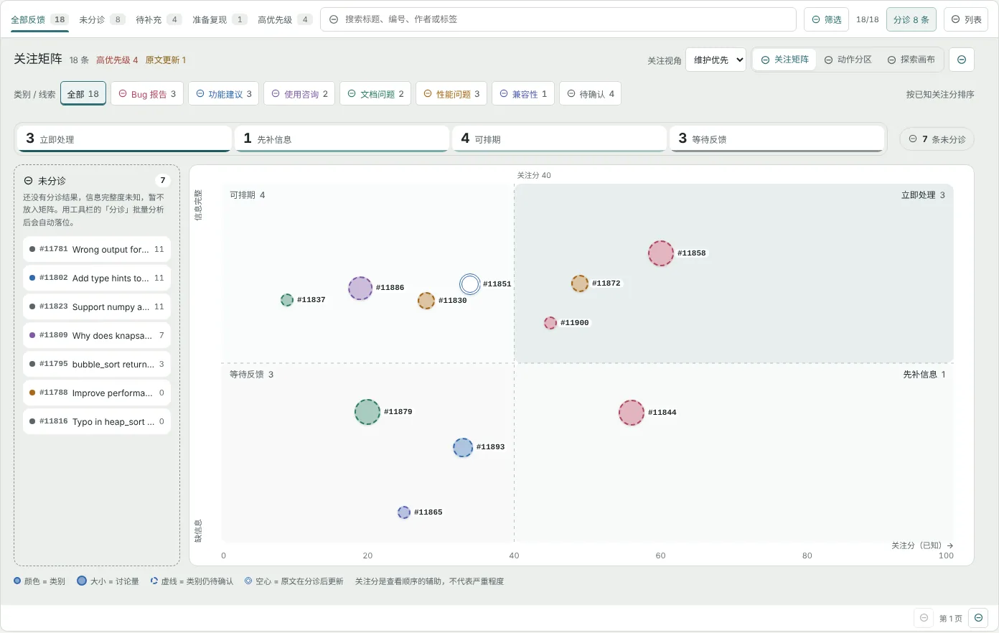
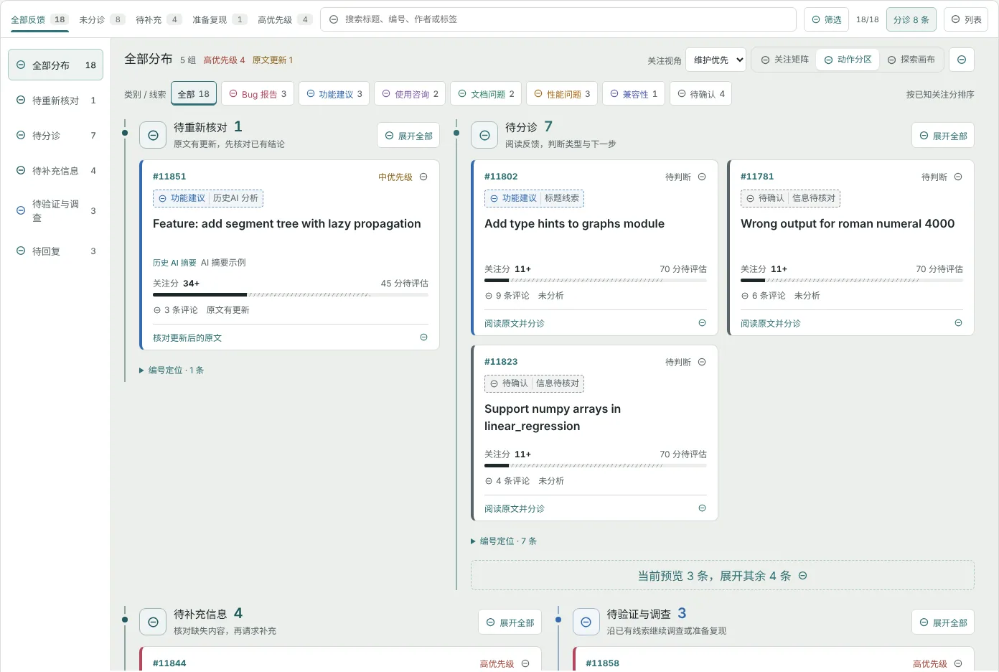

# Issue 分诊

Issue 分诊页帮你在一堆反馈中找到最该先处理的那几条，读懂原文和证据，得到 AI 分诊建议，然后由你确认类型与处理方式、准备回复，或进一步复现 Bug。

## 页面结构

| 区域 | 内容 |
| --- | --- |
| 工具栏 | 处理范围标签（全部反馈 / 未分诊 / 待补充 / 准备复现 / 高优先级）、搜索、筛选、批量分诊、切换列表 |
| 视图区 | 关注矩阵、动作分区、探索画布三种视图，以及关注视角和类别筛选 |
| 详情 | 选中一条 Issue 后打开，包含分诊建议、原始讨论、修复与验证 |

列表按页读取开放中的 Issue，每页最多 30 条。搜索（标题、编号、作者或标签）和筛选只作用于当前页，换页可以查看其他记录。

## 关注矩阵

关注矩阵是默认视图，把**已分诊**的 Issue 放到一张二维图上：

- **横轴：已知关注分**（0–100）。越靠右越值得先看，计算方法见[关注分](#关注分)。竖直虚线是 40 分的分界线。
- **纵轴：信息完整度**。上半区是分诊时没有记录缺失信息的 Issue；下半区是缺少复现步骤、日志、版本等信息的 Issue，缺得越多越靠下。

四个象限对应四种处理方式：

| 象限 | 位置 | 建议动作 |
| --- | --- | --- |
| 立即处理 | 右上：关注分高，信息完整 | 优先阅读并处理，可以直接调查或准备复现 |
| 先补信息 | 右下：关注分高，但缺信息 | 先向报告者请求补充，再判断 |
| 可排期 | 左上：关注分较低，信息完整 | 按计划处理 |
| 等待反馈 | 左下：关注分较低且缺信息 | 等待报告者补充 |

**怎么读一个气泡**

- **颜色**表示类别：Bug 报告为玫红、功能建议为蓝、使用咨询为紫、文档问题为绿、性能问题为琥珀、兼容性为靛蓝、安全问题为红、其他为灰。
- **大小**表示讨论量（评论越多越大）。
- **虚线边框**表示类别还待确认（来自标签或标题线索，或 AI 建议尚未经维护者确认）。
- **双线空心**表示原文在分诊之后被编辑过，结论需要重新核对。

把鼠标移到气泡上，右下角会显示标题、象限、关注分、缺失信息数、优先级和评论数；点击气泡打开详情。

**顶部统计条**显示每个象限的数量，点击某一项可以突出显示该象限，再次点击取消。

**未分诊托盘**：还没有分诊结果的 Issue 信息完整度未知，RepoCare 不会为它们编造位置，而是放在左侧托盘里，按已知关注分排序。用工具栏的“分诊”批量分析后，它们会自动落到矩阵中。

> [!NOTE]
> 40 分的分界线只是帮助你决定查看顺序的辅助线，不是严重程度阈值。“立即处理”也只表示值得先看，最终判断仍由你作出。

## 关注分

关注分是几项已知信号的规则加权和，满分 100。分值后面带 `+` 表示还有部分信号未知、权重待评估。工具栏的“关注视角”可以切换两套权重：

| 信号 | 维护优先 | 响应优先 | 计算方式 |
| --- | --- | --- | --- |
| 已有优先级 | 45 | 25 | 高 / 中 / 低分别取该项权重的 100% / 55% / 20%；未判断时记为待评估 |
| 分析时效 | 25 | 20 | 分诊后原文有更新时得满分，提醒你重新核对；未分诊时待评估 |
| 讨论量 | 15 | 30 | 按评论数对数增长；评论数未知时待评估，不当作零 |
| 静置时长 | 15 | 25 | 距上次更新越久分越高，90 天封顶；时间缺失时待评估 |

在详情或画布中选中一条 Issue，可以展开“关注分依据”查看每一项得分和原因。类别线索不参与计分；未知项不会被当作低风险。

## 类别与线索

类别筛选条（类别 / 线索）可以按类别筛选当前页，数字包含尚待确认的线索。类别的来源按可信度依次是：

| 来源 | 样式 | 说明 |
| --- | --- | --- |
| 维护者确认 | 实线 | 你保存过的最终分类 |
| AI 分析 | 虚线 | 已保存的 AI 分诊结果，仍需核对 |
| 标签线索 | 虚线 | GitHub 标签精确匹配类别词表，例如 `bug`、`type: feature` |
| 标题线索 | 虚线 | 标题中的关键词匹配，例如“报错”“如何”“性能” |
| 多类线索 / 信息待核对 | 虚线 | 线索指向多个类别，或标题过短、只有链接，需阅读正文 |

线索只用于导航，不会保存为正式分诊，也不会推断严重程度；没有明确线索时显示“待确认”，不会强行归类。

## 动作分区与探索画布

**动作分区**按“下一步要做什么”把 Issue 分组，适合逐条处理：

| 分组 | 含义 | 卡片上的动作 |
| --- | --- | --- |
| 待重新核对 | 原文在分诊后有更新 | 核对更新后的原文 |
| 待维护者决策 | 需要人工确认处理方向 | 确认处理方向 |
| 待分诊 | 尚未分诊 | 阅读原文并分诊 |
| 待补充信息 | 分诊发现缺少关键信息 | 核对缺失信息 |
| 待验证与调查 | 已有线索，可以调查或准备复现 | 查看调查与复现线索 |
| 待回复 | 可以准备回复 | 审阅回复建议 |
| 已回复 | 已处理 | 查看处理记录 |

每组默认预览前几张卡片，点击“展开全部”查看其余，或用“编号定位”按编号跳转。左侧的分组列表可以只看某一组。

**探索画布**把所有 Issue 平铺在可缩放的画布上，适合整体浏览：滚轮缩放，拖动空白处或按住中键平移，按 `0` 或点击“适应全部”恢复全图。

## 分诊一条 Issue

1. 在任一视图中点击 Issue，打开详情。详情有三个标签：**分诊建议**、**原始讨论**、**修复与验证**。
2. 在“原始讨论”中阅读正文和评论时间线。完成 AI 分诊后，这里会同时显示中文译文。
3. 回到“分诊建议”，点击“开始 AI 分诊”（详情中的按钮为“分析并翻译”）。分析会调用默认模型，单次请求最长 60 秒。
4. 阅读分析结果：

| 字段 | 内容 |
| --- | --- |
| 问题类型 / 优先级 / 置信度 | 八种类别之一，高 / 中 / 低 / 待判断 |
| 建议动作 | 请求补充信息、直接回复、先调查、评估功能、考虑关闭、人工判断 |
| 判断依据与阻塞项 | 模型给出结论的理由，以及阻止处理的因素 |
| 实际 / 预期 / 环境 | 从原文中提取的实际行为、预期行为和运行环境；没有提到的显示“未提取”“未说明”“未提供” |
| 信息完整度与建议标签 | 已经提供了什么、还缺什么，以及建议添加的 GitHub 标签 |

5. 查看“处理准备度与下一步”。RepoCare 按规则估计信息准备度——**可进入复现**、**部分准备** 或 **信息不足**——并给出对应按钮：生成复现方案、生成补充信息回复或生成回复草稿。

> [!TIP]
> 信息不足时先请求补充，不要急于复现。没有复现成功不能证明 Issue 无效，只说明当前信息和环境下没有触发。

**批量分诊**：工具栏的“分诊 N 条”会按当前页顺序，对当前筛选结果中尚未分诊的 Issue 逐条建立分诊建议，每次最多 12 条。所有分诊都会调用模型。

**项目专属规则**：如果在设置中启用了[项目专属规则](settings.md#项目专属规则)，分诊会同时核对必填信息、支持的运行时版本和标签映射。例如报告的 Python 版本不在支持列表中时，会提示“检测到支持列表外版本”，但不会自动关闭 Issue。

## 确认你的判断

AI 结果只是建议。在“维护者确认”区域：

1. 选择最终类型、最终优先级和最终状态（未分诊、待补充信息、准备复现、准备回复、待调查、已回复、人工审阅）。
2. 可选：在“维护者判断依据”中记录理由。
3. 点击“保存维护者判断”。

确认后，矩阵和动作分区会使用你的判断，并以实线标记“维护者确认”。原始的 AI 分析会保留，不会被覆盖。

## 写入 GitHub

连接了有写入权限的 GitHub 账户后，“维护动作”区域可以修改 Issue 的状态（开放 / 关闭）、标签和指派人：

1. 编辑标签和指派人（多个用逗号分隔），或点击“应用 AI 建议标签到编辑框”。
2. 点击“保存标签与指派”，在确认框中核对将要写入的内容，再点击“确认写入”。

没有写入权限时，这一区域显示为只读。

**可能相关**：详情中会列出当前页里标题、正文和类型相近的候选 Issue，方便你发现重复反馈。这只是轻量匹配，不会自动标记重复。

## 准备回复

点击“生成回复草稿”（或信息不足时的“生成补充信息回复”），RepoCare 会基于原文和分诊结果生成回复，保存为草稿。草稿生成后，可以点击“审阅刚生成的草稿”进入[草稿与交付](drafts.md)编辑和发布。生成不会直接回复到 GitHub。

## 复现 Bug

对于信息足够的 Bug，可以在“修复与验证”中准备一次隔离复现。复现目前只支持公开 GitHub 仓库，并且需要部署已[启用隔离执行](deployment.md#启用隔离执行)。

1. 点击“生成复现方案”。方案包括复现策略（浏览器交互、HTTP 接口、项目测试或命令验证）、置信度、**机器判据**（怎样算复现成功）、环境与执行步骤、预期故障，以及风险和仍缺少的信息。
2. 逐项审阅方案，确认机器判据确实对应报告中的故障。
3. 点击“确认隔离执行”。任务固定提交 SHA，在 Docker Runner 中执行：执行期间断网、只读根文件系统、不授予 capabilities，并限制 CPU、内存和进程数。
4. 页面每 2 秒同步一次 Worker 状态，离开页面后任务仍会继续。执行流程依次为：方案确认 → 准备固定版本 → 准备测试依赖 → 隔离执行验证 → 整理证据报告。

**复现结果**

| 结果 | 含义 |
| --- | --- |
| 稳定复现 | 默认执行 3 次，至少 2 次命中机器判据 |
| 未稳定复现 | 命中次数未达到阈值 |
| 环境阻塞 | 执行环境不满足条件，例如依赖无法安装 |
| 计划不安全 | 方案未通过安全校验，不会执行 |
| 执行失败 | 隔离执行本身未完成 |

证据链可能包括标准输出、错误输出、页面截图、浏览器 Trace、操作视频、网络记录、控制台、堆栈和测试结果，每个文件都记录 SHA-256，下载时重新校验。

> [!WARNING]
> 环境阻塞、网络失败或依赖缺失不是对 Bug 本身的判断。不要把它们记为“Bug 已修复”或“Bug 不存在”。

Docker Runner 未启用时，确认后任务会安全阻塞，不会在宿主机执行；复现 Worker 离线时，任务进入队列，等 Worker 启动后再执行。

## 修复与验证

复现之后，可以在同一标签中点击“准备修复建议”，围绕这个 Issue 启动[维护调查](maintenance.md)：读取源码证据、准备候选补丁，并对修复前后的版本运行同一组测试。

## 原文更新之后

Issue 在分诊后被编辑，分诊结果会标为“原文已更新，需要重新分析”，矩阵中的气泡变为双线空心，并出现在动作分区的“待重新核对”中。历史分析仍然保留，但应重新分诊后再据此行动。
