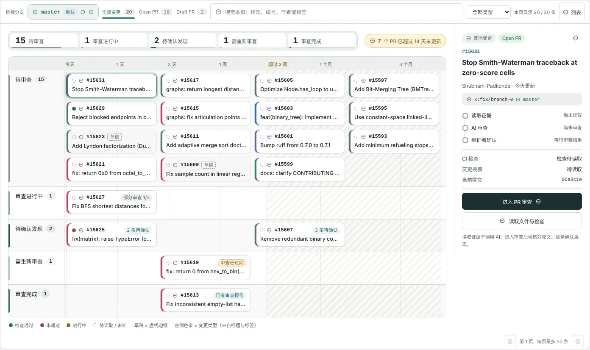

# PR 检查

PR 检查页回答两个问题：哪些变更卡住了、卡了多久？某个 PR 的改动有没有问题？前者由审查航道一眼呈现，后者通过分块 AI 审查和你的逐条筛选完成，最后生成一份可以发布的审阅评论。

## 页面结构

| 区域 | 内容 |
| --- | --- |
| 工具栏 | 目标分支选择器、范围标签（全部变更 / Open PR / Draft PR）、本页搜索、变更类型筛选、切换列表 |
| 审查航道 | 按审查阶段分道、按空闲时间排布的 PR 票卡 |
| 观察面板 | 选中 PR 的摘要、审查进度和下一步操作（窄屏时移到航道上方） |

页面默认打开仓库**默认分支**的开放 PR。每页最多 30 条，搜索和类型筛选只作用于当前页。

## 选择目标分支

PR 按合并目标分支（base）分组查看。点击工具栏左侧的“目标分支”按钮，在弹出的列表中搜索并选择分支，默认分支带有“默认”标记。切换分支后，航道和统计都会按新分支重新读取。

## 审查航道

**纵向五条泳道**对应审查阶段。阶段只来自已保存的审查记录，不会根据标题、时间或标签推测：

| 阶段 | 判定方式 |
| --- | --- |
| 待审查 | 还没有审查记录 |
| 审查进行中 | 分块审查正在排队、执行，或部分完成、已取消 |
| 待确认发现 | 审查已完成，还有未处理的发现 |
| 需重新审查 | PR 有新提交或项目规则变了，原审查已过期 |
| 审查完成 | 审查完成且没有待确认的发现 |

**横轴**表示 PR 距上次更新多久，使用对数刻度：近期的变化有足够间距，几个月没动的 PR 也仍在可见范围内。超过 14 天的区域用斜纹标出，顶部会提示“N 个 PR 已超过 14 天未更新”。

**一张票卡**包含：

- 左侧色条：变更类型（功能、修复、文档、依赖、其他），来自标题和标签线索；
- 圆点：CI 状态——绿色通过、红色未通过、琥珀色进行中、虚线圆表示未读取或未知；
- 编号与标题；草稿 PR 使用虚线边框并标注“草稿”；
- 已有审查记录时显示审查标签，例如“部分审查 1/3”“2 条待确认”“审查已过期”“已有审查报告”。

**顶部统计条**显示每个阶段的数量和占比，点击可以突出显示单条泳道。每条泳道最多显示 6 行，其余可以点击“展开其余 N 个”。容器宽度不足时，泳道会改为按空闲时间排序的票卡网格。

> [!NOTE]
> 横向位置只表示空闲时间，不代表风险或优先级。CI 未知不等于通过。

## 观察面板

选中一张票卡，右侧观察面板会显示：

- 类型与状态、标题、作者与空闲时长；
- 来源分支 → 目标分支；
- 三步审查进度：**读取证据 → AI 审查 → 维护者确认**；
- CI 检查、变更规模和当前提交。

面板提供三个操作：

- **读取文件与检查**：读取当前提交的文件改动和 CI 检查清单。**不调用 AI**，结果在航道下方展开。
- **进入 PR 审查**：打开详情，阅读原文、发起 AI 审查、筛选发现。
- **在 GitHub 打开**。

默认选中本页第一条，但不会自动读取证据或调用模型。

## 读取证据

“读取文件与检查”之后，航道下方会展开三部分：

- **文件改动谱**：每个文件的新增和删除行数，所有柱形使用同一比例尺。点击文件可以查看 Diff 片段（最多前 40 行）。增删行数不表示风险或测试覆盖率；文件清单被截断时会注明统计只涵盖已读取部分。
- **可见检查**：读取到的 GitHub Checks 及其状态。最终能否合并由 GitHub 决定；没有检查条目时不推断为通过。
- **需求连接**：PR 声明关联的 Issue。关联声明不证明需求已经修复。

## 发起 AI 审查

在 PR 详情中点击“开始 AI 审查”。RepoCare 会固定当前的 head 和 base 提交，把 Diff 按文件和变更段切成若干块，逐块交给模型审查，每块的结果完成后立即保存。

| 状态 | 含义 |
| --- | --- |
| 待审 | 等待处理 |
| 审查中 | 正在调用模型 |
| 已完成 | 该块可见范围已处理 |
| 失败 | 模型调用失败，可以单独重试 |
| 未审 | 超出预算、文件过大或 Diff 不可用，没有送入模型 |

- 离开页面不会取消审查；需要停止时点击“停止审查”，已保存的结果保留。
- 有失败块时，等任务结束后点击“仅重试失败块”，已完成的结果保留，沿用原来的模型。每块最多尝试 3 次。
- PR 有新提交或规则变化后，点击“重新审查当前版本”。

> [!IMPORTANT]
> 审查有明确的范围限制：单个任务最多 32 个可执行块；GitHub 未提供文本 Diff 的文件（二进制或过大）、超长单行，以及超出预算的部分会标为“未审”。报告包含未审范围时，不能视为完整审查。RepoCare 不运行 PR 的测试，模型只看各块可见的 Diff，跨块影响仍需人工核对。

## 筛选审查发现

每条发现包含严重程度、置信度、位置和说明：

| 严重程度 | 含义 |
| --- | --- |
| 阻塞问题 | 可能导致错误或不应合并的问题 |
| 需要关注 | 值得作者确认或修改 |
| 改进建议 | 可选的改进 |
| 信息 | 补充说明 |

对每条发现：

1. 展开“已核对 Diff 原文”，对照代码确认问题真实存在。没有可核实代码证据的发现会标注“仅待核实线索”，不能直接确认发布。
2. 点击 **确认发现** 或 **忽略**。判断有误时可以“撤回判断”重新筛选。
3. 结合“审查边界”查看读取范围、测试证据和被截断的文件。

AI 没有提出问题，也不等于测试已经通过。

## 生成审阅评论

1. 筛选完所有发现后，勾选“我已逐项筛选 AI 线索，理解生成草稿不会批准或合并 PR，且未在 RepoCare 执行测试”。
2. 点击“生成已筛选审阅草稿”，只有你确认的发现会进入草稿。
3. 点击“打开草稿工作台编辑与确认发布”，在[草稿与交付](drafts.md)中编辑语气和内容，发布为 COMMENT 类型的审阅。

发布的是评论型审阅，不会批准、请求修改或合并 PR，这些决定仍在 GitHub 的工作流中完成。

## 核对需求与改动

PR 详情中的“需求与变更核对”可以围绕这个 PR 启动[维护调查](maintenance.md)：把 PR 描述和关联 Issue 中的要求逐条对应到改动，并在支持的项目中对基线和候选版本运行同一组测试。

## 项目专属规则

启用[项目专属规则](settings.md#项目专属规则)后，PR 审查会额外核对：

- **PR 必须检查**：指定的 GitHub 检查是否存在，以及采集时的状态（RepoCare 不执行这些检查）；
- **PR 测试变更**：读取范围内是否有测试路径的变更。有变更不代表覆盖充分，没有变更会提醒你核对是否需要回归测试。

规则或 PR 变化后，旧的审查会标为历史记录，需要重新审查后再确认或生成草稿。

## 使用限制

- 同一账户最多同时排队或运行 3 个 PR 审查任务，每小时最多创建 30 个。
- 每块一次模型调用，格式不正确时最多修复一次。
- 审查任务由维护 Agent Worker 处理；Worker 离线时任务会排队，恢复后继续。
